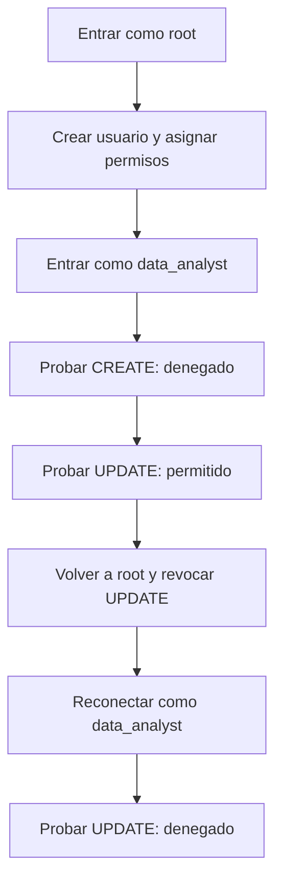

<div align="center">
  <a href="https://www.mysql.com/">
    
  </a>

  # Administración de usuarios en MySQL

  <p><strong>Clase 19 · Base de Datos II</strong></p>
  <p>Práctica de creación de usuarios, permisos y control de acceso sobre la base de datos <code>sakila</code></p>

  <p>
    
    
    
    
  </p>

  <p>
    <a href="#objetivo">Objetivo</a> ·
    <a href="#ejercicios">Ejercicios</a> ·
    <a href="#ejecucion">Ejecución</a> ·
    <a href="#resultados">Resultados</a> ·
    <a href="#referencias">Referencias</a>
  </p>
</div>

---

<a id="objetivo"></a>

## 📌 Objetivo

Trabajar con los permisos básicos de MySQL creando el usuario `data_analyst`, que pueda consultar, modificar y eliminar registros de `sakila`, pero **no crear tablas**

Después se le quita el permiso `UPDATE` para comprobar que ya no puede editar los datos de una película

> [!NOTE]
> El archivo está organizado por pasos porque las consultas se ejecutan con **dos usuarios distintos**: `root` y `data_analyst`

## 📁 Archivos del proyecto

```text
class-19-mysqladministration-Segura-Bruno/
├── README.md
└── mysql_administration.sql
```

| Archivo | Contenido |
| :--- | :--- |
| [`mysql_administration.sql`](./mysql_administration.sql) | Los 6 ejercicios con las consultas SQL y comentarios |
| `README.md` | Explicación, instrucciones de ejecución y resultados esperados |

---

<a id="ejercicios"></a>

## 🧩 Ejercicios

| Paso | Acción | Usuario que lo ejecuta |
| :---: | :--- | :---: |
| **01** | Crear `data_analyst` | `root` |
| **02** | Dar permisos `SELECT`, `UPDATE` y `DELETE` en `sakila` | `root` |
| **03** | Intentar crear una tabla sin tener permiso `CREATE` | `data_analyst` |
| **04** | Cambiar el título de una película | `data_analyst` |
| **05** | Quitar el permiso `UPDATE` | `root` |
| **06** | Intentar cambiar el título nuevamente | `data_analyst` |

<details>
  <summary><strong>🔐 Ver los permisos del usuario</strong></summary>
  <br />

  | Permiso | Antes del `REVOKE` | Después del `REVOKE` |
  | :--- | :---: | :---: |
  | `SELECT` | ✅ | ✅ |
  | `UPDATE` | ✅ | ❌ |
  | `DELETE` | ✅ | ✅ |
  | `CREATE` | ❌ | ❌ |

  El alcance de estos permisos es `sakila.*`, no todas las bases de datos del servidor
</details>

---

<a id="ejecucion"></a>

## ⚙️ Cómo ejecutarlo

### Requisitos

- MySQL instalado, preferentemente **MySQL 8.x**
- Base de datos de ejemplo **`sakila`** importada
- Acceso a `root` o a otro usuario con permisos para administrar usuarios
- MySQL Workbench o una terminal para ejecutar las consultas

### 1. Entrar como administrador

Desde MySQL Workbench podés abrir una conexión como `root`, o usar la terminal:

```bash
mysql -u root -p
```

Ejecutar **solo los pasos 1 y 2** del archivo SQL para crear el usuario y asignarle permisos

```sql
create user if not exists 'data_analyst'@'localhost'
identified by 'Bd2_2026_prueba!';

grant select, update, delete on sakila.*
to 'data_analyst'@'localhost';

show grants for 'data_analyst'@'localhost';
```

### 2. Entrar como `data_analyst`

Abrir otra conexión usando el usuario creado y la contraseña definida en el script

```bash
mysql -u data_analyst -p sakila
```

Ejecutar **el paso 3** para intentar crear una tabla y **el paso 4** para editar el título de la película con `film_id = 1`

<details>
  <summary><strong>📝 Ver la consulta para editar la película</strong></summary>
  <br />

  ```sql
  update film
  set title = 'ACADEMY DINOSAUR EDITADA'
  where film_id = 1;

  select film_id, title from film where film_id = 1;
  ```
</details>

### 3. Volver a `root` y quitar `UPDATE`

Ejecutar **el paso 5** en la conexión de administrador:

```sql
revoke update on sakila.*
from 'data_analyst'@'localhost';

show grants for 'data_analyst'@'localhost';
```

### 4. Comprobar el cambio

Volver a conectarse como `data_analyst` y ejecutar **el paso 6** intentando modificar otra vez la misma película

```sql
update film
set title = 'ACADEMY DINOSAUR OTRA VEZ'
where film_id = 1;
```

Como el permiso `UPDATE` fue revocado, esa operación debería ser rechazada

> [!IMPORTANT]
> **No ejecutes todo el `.sql` de una sola vez** porque algunas consultas necesitan `root` y otras necesitan `data_analyst` Además, los errores de permisos son parte de la práctica

---

<a id="resultados"></a>

## ✅ Resultados esperados

| Prueba | Resultado esperado |
| :--- | :--- |
| Crear una tabla con `data_analyst` | ❌ MySQL rechaza la operación por falta de `CREATE` |
| Editar el título antes del `REVOKE` | ✅ Se modifica la película |
| Consultar `SHOW GRANTS` después del `REVOKE` | ✅ Ya no aparece `UPDATE` para `sakila.*` |
| Editar el título después del `REVOKE` | ❌ MySQL rechaza la operación por falta de `UPDATE` |

<details>
  <summary><strong>🚫 Ver un ejemplo de error esperado</strong></summary>
  <br />

  Al intentar crear una tabla o actualizar una película sin permiso, MySQL normalmente devuelve un error de este tipo:

  ```text
  ERROR 1142 (42000): CREATE command denied to user ...
  ERROR 1142 (42000): UPDATE command denied to user ...
  ```

  El mensaje completo puede variar según la versión, el cliente y el usuario utilizado Estas líneas son **ejemplos**, no capturas de una ejecución real
</details>

### Flujo de la práctica



---

## 🔎 Comandos principales

<details>
  <summary><strong>Mostrar los comandos usados en la práctica</strong></summary>
  <br />

  | Comando | Para qué se usa |
  | :--- | :--- |
  | `CREATE USER` | Crear una cuenta en MySQL |
  | `GRANT` | Dar permisos a un usuario |
  | `SHOW GRANTS` | Consultar los permisos asignados |
  | `CREATE TABLE` | Intentar crear una tabla para comprobar restricciones |
  | `UPDATE` | Modificar un registro |
  | `SELECT` | Consultar los datos |
  | `REVOKE` | Quitar permisos |
</details>

> [!WARNING]
> La contraseña del `.sql` es **solo para una práctica local** Está escrita en el archivo para facilitar el ejercicio, así que no hay que reutilizarla en un servidor real ni publicar credenciales de producción

---

<a id="referencias"></a>

## 🔗 Referencias

<p>
  <a href="https://github.com/FrattinJuan/itsv-db-2/blob/master/classes/mysql_administration.md">
    
  </a>
  <a href="https://dev.mysql.com/doc/refman/8.4/en/account-management-statements.html">
    
  </a>
  <a href="https://dev.mysql.com/doc/sakila/en/">
    
  </a>
</p>

---

<div align="center">
  <p><strong>Bruno Segura</strong> · Base de Datos II · Clase 19</p>
  <sub>Práctica de administración de usuarios y permisos en MySQL</sub>
</div>
